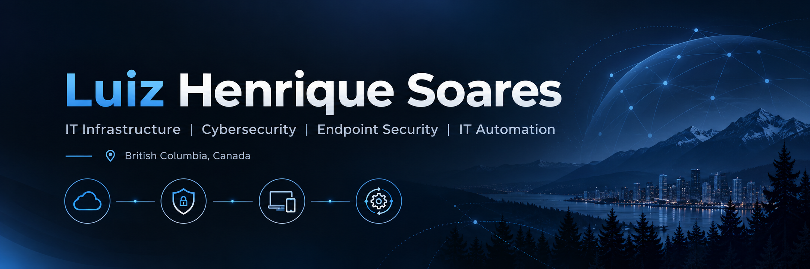

<h2>🏅 Featured Certifications</h2>

  
  
  
  

  
  
  
  

# Hi there! I'm Luiz Henrique 👋

### IT Infrastructure | Cybersecurity | Endpoint Security | IT Automation

📍 British Columbia, Canada 🇨🇦

I'm an IT professional with experience in **IT support, infrastructure administration, system troubleshooting, and information security**.

My technical background includes supporting enterprise environments, administering Windows systems, managing user accounts and network services, and resolving complex technical issues.

I have supported IT environments serving **1,000+ users**, with experience in Active Directory, Windows Server, DNS, DHCP, VPN, endpoint troubleshooting, and IT service management.

I'm passionate about continuous learning, cybersecurity, cloud technologies, and IT automation.

My goal is to combine professional certifications with practical projects that demonstrate real-world technical skills.

---

## 🚀 What I'm Currently Working On

- 🖥️ **Microsoft Intune Endpoint Security Lab** — Building a simulated enterprise environment for endpoint management and security.
- ☁️ **Microsoft Endpoint Administration (MD-102)** — Currently studying Microsoft Intune, Microsoft Entra ID, endpoint security, and device compliance.
- 🛡️ **Cybersecurity Labs** — Developing practical skills in security monitoring, vulnerability assessment, and incident response.
- ⚙️ **PowerShell Automation** — Building scripts to improve IT administration, system auditing, and troubleshooting.

---

<h2>🏅 Professional Certifications</h2>

  <strong>17 Certifications Earned</strong> |
  Cybersecurity • Cloud • IT Service Management • Governance & Compliance

<h3>🛡️ CompTIA — Cybersecurity</h3>

  
  
  
  

<h3>☁️ Microsoft — Cloud, Security & AI</h3>

  
  
  

<h4>📚 Currently Studying</h4>

  

<h3>🔐 Information Security, Privacy & Compliance</h3>

  
<strong>EXIN — View 4 Certifications</strong>

   

  

    
    
    
    
  

  <ul>
    <li>EXIN Ethical Hacking Foundation</li>
    <li>Information Security Foundation based on ISO/IEC 27001</li>
    <li>Information Security Management Professional based on ISO/IEC 27001</li>
    <li>EXIN Privacy and Data Protection Foundation</li>
  </ul>

 

  
<strong>IT Service Management — View 2 Certifications</strong>

   

  

    
    
  

  <ul>
    <li>ITIL v3 Foundation</li>
    <li>IT Service Management Foundation based on ISO/IEC 20000</li>
  </ul>

 

  
<strong>ISO 27001 — View Internal Auditor Certification</strong>

   

  

    
  

  <ul>
    <li>Certified ISO 27001 Internal Auditor (I27001IA)</li>
  </ul>

 

  
<strong>ITCerts — View 3 Certifications</strong>

   

  

    
    
    
  

  <ul>
    <li>Green IT Essentials Certification</li>
    <li>GDPR Foundation</li>
    <li>LGPD Foundation</li>
  </ul>

  <em>My certifications support my continuous professional development in cybersecurity, IT infrastructure, privacy, governance, and modern endpoint administration.</em>

---

## 💻 Technical Skills

### IT Infrastructure & System Administration

- Windows 10/11 and Windows Server
- Active Directory and Group Policy
- DNS, DHCP, TCP/IP, and VPN
- User and access management
- Network troubleshooting
- Hardware and software support
- Endpoint troubleshooting and maintenance
- IT asset management

### Cybersecurity

- Vulnerability Assessment
- Security Monitoring and Analysis
- Endpoint Protection
- Information Security Management
- Risk Assessment
- Security Policies and Compliance
- Incident Response Fundamentals
- Security Awareness and Phishing Analysis

### Microsoft Cloud & Endpoint Management

- Microsoft Azure Fundamentals
- Microsoft Entra ID
- Microsoft Intune — Hands-on Lab in Progress
- Endpoint Configuration and Compliance
- Microsoft Defender
- Microsoft 365 Administration Concepts

### IT Governance & Compliance

- ISO/IEC 27001
- ISO/IEC 20000
- ITIL v3
- GDPR
- LGPD
- Privacy and Data Protection
- Green IT and Sustainability

### Automation & Tools

- PowerShell — Practical Projects in Progress
- Python — Practical Projects in Progress
- Git & GitHub
- Windows Administration Tools
- Microsoft Graph API — Learning

---

## 🧪 Featured Projects

### 🖥️ Microsoft Intune Endpoint Security Lab

**Status: In Progress**

A hands-on project simulating IT operations and endpoint management for a fictional organization.

**Project Goals:**
- Configure Microsoft Entra ID users and security groups.
- Manage Windows endpoints using Microsoft Intune.
- Implement endpoint security policies.
- Evaluate device compliance.
- Explore Microsoft Defender and BitLocker configuration.
- Configure Windows Update management.
- Automate administrative tasks with PowerShell and Microsoft Graph.
- Document deployment, troubleshooting, and security considerations.

**Technologies:** Microsoft Intune, Microsoft Entra ID, Windows 11, Microsoft Defender, PowerShell, Microsoft Graph.

### 🛡️ Windows Security Audit Toolkit

**Status: Planned**

A PowerShell-based toolkit for auditing endpoint security configurations, including Windows Defender, Firewall, BitLocker, system updates, and local security settings.

### 🔍 SOC Detection & Incident Response Lab

**Status: Planned**

A practical security monitoring project exploring event collection, threat detection, security alerts, and incident investigation.

### ⚙️ IT Support Automation Toolkit

**Status: Planned**

A collection of PowerShell and Python tools designed to simplify IT support, device inventory, system diagnostics, and common troubleshooting workflows.

---

## 🎓 Education & Professional Development

My educational background includes:

- Degree in Information Technology
- Postgraduate studies in Cybersecurity
- Information Security Management
- IT Governance and Management
- Computer Network Security

My professional development focuses on connecting cybersecurity, infrastructure, service management, and modern endpoint administration.

---

## 🎯 Professional Interests

I'm interested in opportunities involving:

- IT Support Analyst / Technical Support Specialist
- IT Infrastructure Analyst
- Systems Administrator
- Microsoft Endpoint Administrator
- Cybersecurity Analyst
- Security Operations
- IT Security & Compliance

I value continuous improvement, technical documentation, structured troubleshooting, and practical problem-solving.

---

## 🤝 Let's Connect

I'm always interested in connecting with IT professionals, cybersecurity practitioners, and technology enthusiasts.

Feel free to explore my repositories, follow my learning journey, or connect with me on LinkedIn.

**Thanks for visiting my GitHub profile! 🚀**

*Learning continuously. Building practically. Securing what matters.*
